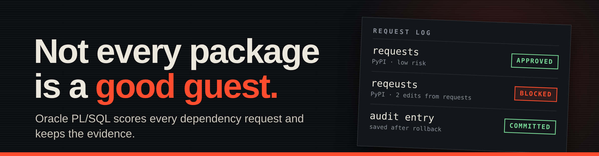

# pkgShield: Open-Source Supply Chain Package Firewall in Oracle PL/SQL

**Student:** Ishimwe Semuhungu Daniel | **ID:** 20251SEN037
**Course:** INSY 8311 Database Development with PL/SQL | **Instructor:** Eric Maniraguha

## Problem statement

Developers run `npm install` or `pip install` without checking package integrity. Attackers exploit this with typosquatted names, hijacked maintainer accounts and malicious versions. Sonatype reported a 156% year-over-year increase in malicious open-source packages in 2024. Teams need a check that runs at the moment a dependency is requested for a build, and a record of every decision that cannot be erased.

## Objectives

**Main objective:** build an Oracle PL/SQL database that acts as a gate: it scores each requested dependency and blocks risky ones before they reach a build.

Specific objectives:
1. Load real advisory and malicious-package data into 3NF tables.
2. Compute a 0 to 100 risk score per package version with a documented formula.
3. Block risky or blacklisted dependency requests with a trigger.
4. Record every blocked attempt in an audit log that survives rollback.
5. Re-score pending packages automatically on a schedule and raise alerts.

## Data source

| Data | Source | Licence | Real or synthetic |
|------|--------|---------|-------------------|
| Advisories, CVE ids, CVSS, affected packages | GitHub Advisory Database via OSV.dev (npm, PyPI) | CC-BY 4.0 | Real |
| Known malicious package names and versions | Datadog malicious-software-packages-dataset | Apache-2.0 | Real |
| Maintainers, build projects, manifest requests, download trend | Generated by script | n/a | **Synthetic, declared.** No public dataset exists without personal data. Maintainer handles are pseudonyms; no emails are stored. |

Record counts will be added to `data/README.md` after download.

## Innovation

**Option:** Smart automation. `DBMS_SCHEDULER` runs a job that re-scores pending packages and writes rows to a security alerts table. Business rules stay in PL/SQL.

## Planned tables

MAINTAINERS, PACKAGES, PACKAGE_VERSIONS, ADVISORIES, PACKAGE_ADVISORIES, BUILD_PROJECTS, DEPLOYMENT_MANIFESTS, SECURITY_AUDIT_LOG, SECURITY_ALERTS.

## Planned PL/SQL features

- **Autonomous audit procedure** (`PRAGMA AUTONOMOUS_TRANSACTION`): logs a blocked request even though the main transaction rolls back.
- **Risk-score function:** combines CVSS, maintainer reputation and account age.
- **Typosquatting function:** `UTL_MATCH.EDIT_DISTANCE` against popular package names.
- **Evaluation procedure with explicit cursor and `FOR UPDATE`:** locks and evaluates a pending request.
- **Row-level trigger on DEPLOYMENT_MANIFESTS:** raises `RAISE_APPLICATION_ERROR` for blacklisted or high-risk packages.
- **Packages and exception handling** around all of the above.
- **Scheduler job** for the innovation layer.

## Repository layout

```
docs/research/    research log
docs/proposal/    proposal
docs/presentation/ slides
data/             data files and data README
```

## References

See `docs/research/research_log.md` (APA).
